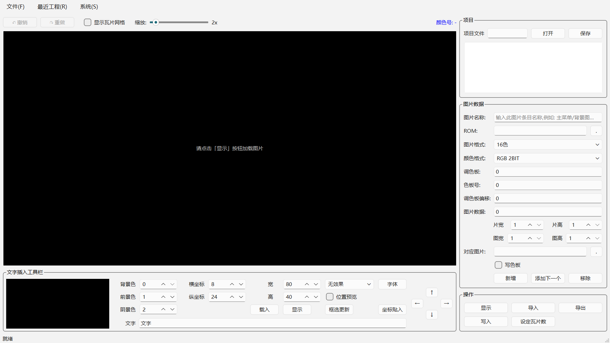
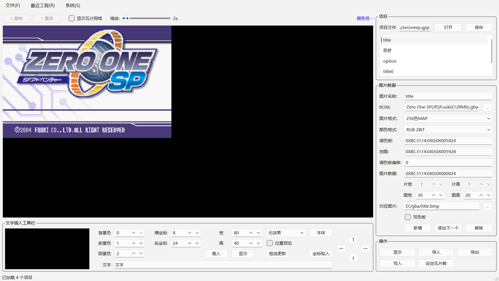
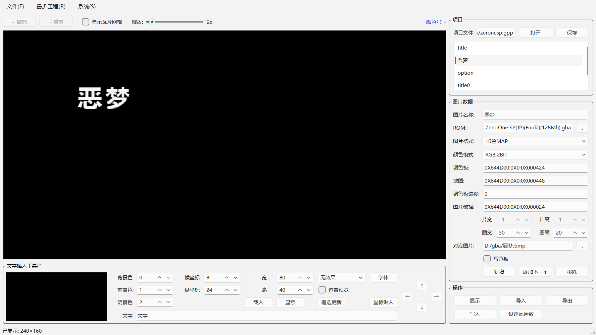
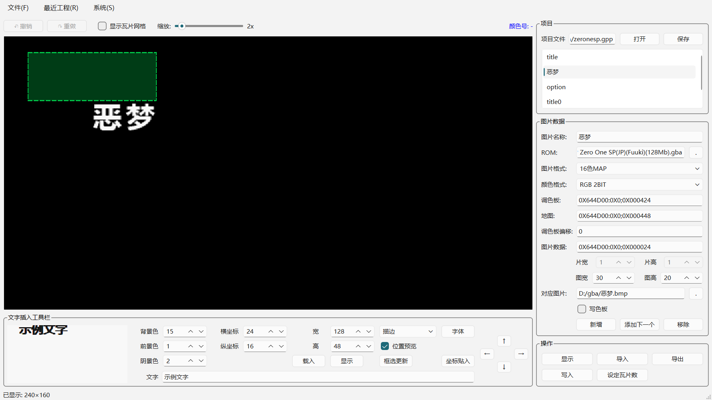
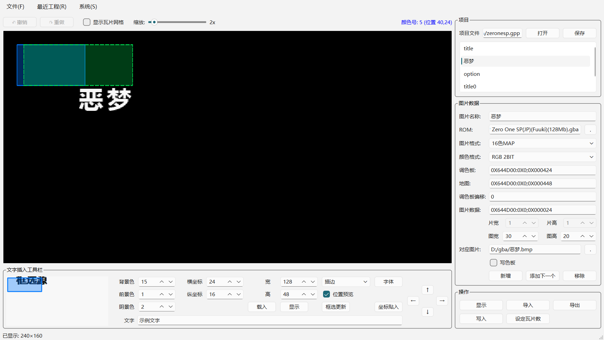
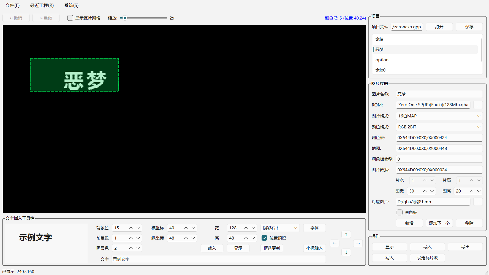
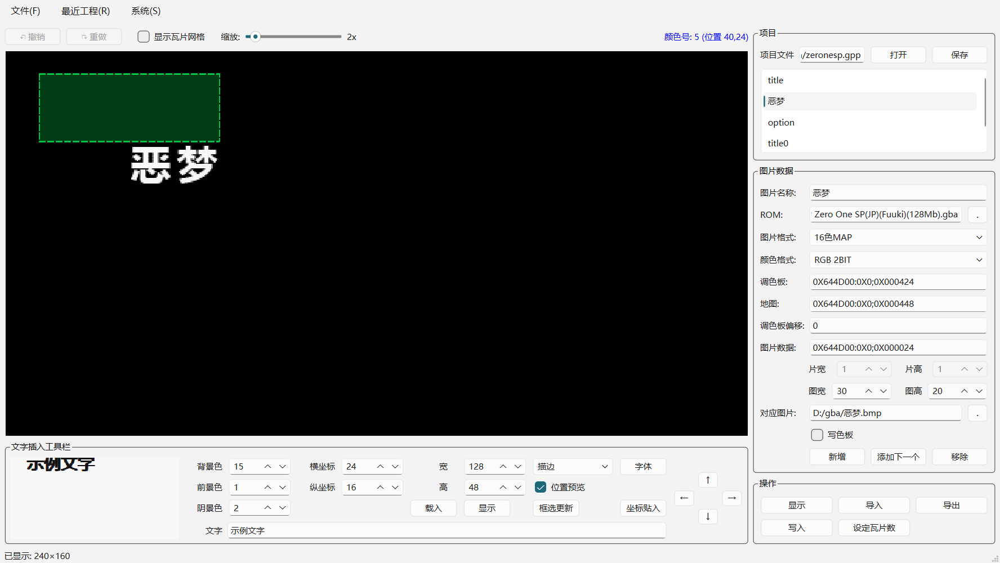

# ROM 图片编辑器：GBA/NDS 游戏改图与汉化入门教程

> 一套支持 LZ77 / RLE / Huffman / Huff+LZ77 压缩格式的 ROM 瓦片图片编辑器
> 兼容老版 .gpp 工程文件（Var1.0 / Var2.0 / Var3.0）

## 一、这是做什么的？

做 GBA/NDS 游戏汉化和改图时，最大的难点不是"画图"，而是**把图片塞回 ROM**。游戏的图形资源不是普通 BMP，而是经过压缩、按瓦片组织的二进制数据——直接改完再写回去，要么写不进，要么游戏崩溃。

本软件就是解决这个问题的：

- 从 ROM 指定地址读取瓦片图片并显示
- 支持 9 种图片格式（16色 / 256色 / 超16色 / MAP 等）
- 支持 5 种地址与压缩格式（RAW / LZ77 / RLE / Huffman / Huff+LZ77）
- 导入导出 BMP/PNG/JPG，改完写回 ROM
- 内置文字插入工具，汉化贴字一步到位

这套教程带你把"读取 → 改图 → 写回"完整流程走一遍。

---

## 二、准备工作

### 2.1 环境要求

- Python 3.12 或更高版本
- PySide6（界面库）
- Pillow（可选，用于导入 PNG/JPG/TIFF）

### 2.2 安装

打开命令行，执行：

```
pip install PySide6 Pillow
```

### 2.3 启动

在项目根目录执行：

```
python main.py
```

启动后看到主窗口（未加载任何工程的状态）：



**主窗口分三块：**

| 区域 | 作用 |
|------|------|
| 左侧画布 | 显示图片，支持缩放、框选、右键取色 |
| 底部工具栏 | 文字插入工具（汉化贴字用） |
| 右侧面板 | 工程条目、ROM/地址/格式参数、操作按钮 |

---

## 三、打开一个现成工程，先看效果

GPP 工程文件保存了游戏里所有图片条目的配置（ROM 路径、地址、格式、尺寸）。打开工程后，左侧列表列出所有图片，**点击任意条目会自动显示**。

1. 菜单「文件」→「打开GPP项目」，或直接点右侧「项目」栏的「打开」按钮
2. 选择 .gpp 文件（比如 Zero One SP 的 `zeronesp.gpp`）
3. 列表出现 4 个条目：title、恶梦、option、title0
4. 点选第一条 `title`，画布立刻显示游戏标题画面



可以看到：

- 画布完整渲染出《ZERO ONE SP》的标题画面（256色MAP，30×20 瓦片，2 倍缩放）
- 右侧面板显示该条目的所有参数：ROM 路径、图片格式、调色板/图片数据地址（这里是 Huff+LZ77 压缩格式）、图宽图高
- 状态栏提示"已加载 4 个项目"

> 注意：这里的地址是 `0XBC3114:0X0;0X005824` 这种格式，表示 Huffman 块地址: LZ77 块地址; 解压后偏移。软件会自动解压显示，不用手动处理。

---

## 四、改图实战：导入与导出

游戏图片通常以 BMP 形式保存素材。工作流是：**导出原图 → 用画图工具修改 → 导入回软件 → 写入 ROM**。

### 4.1 导出当前图片

1. 先点「显示」加载图片
2. 点「导出」按钮
3. 选择保存格式（BMP 或 PNG，PNG 支持色号 0 透明）
4. 若文件已存在会询问是否覆盖（默认选"否"，防止误覆盖）
5. 导出后「对应图片」输入框自动填上导出路径

### 4.2 修改图片

用 PhotoShop / Windows 画图 / Aseprite 等工具修改导出的 BMP。**注意保持尺寸不变**，颜色数量不要超过原图格式限制（16色格式最多 16 种颜色）。

### 4.3 导入修改后的图片

1. 在「对应图片」框填入 BMP 路径；如果路径有效且文件存在，点「导入」会**直接导入，不再弹文件选择框**
2. 勾选「写色板」可以同时把调色板写回
3. 点「导入」按钮，画布更新为修改后的图



### 4.4 写入 ROM

修改满意后，点「写入」按钮，数据就写回 ROM 指定地址：

- 无压缩格式：直接覆盖写入
- 压缩格式：自动重新压缩再写回（LZ77 / Huffman / Huff+LZ77 都支持）
- 如果数据没被修改过，软件会跳过压缩直接写回，避免压缩器差异导致数据膨胀

**写入前务必备份 ROM 文件！**

---

## 五、文字插入：汉化贴字必备

汉化游戏时最常见的工作就是往图片里贴中文。软件底部有专门的「文字插入工具栏」。



### 5.1 工具栏参数

**颜色相关**

| 参数 | 作用 |
|------|------|
| 背景色 | 文字底垫的调色板色号，不想要背景设为 0 |
| 前景色 | 文字主体的调色板色号 |
| 阴景色 | 描边 / 阴影效果用的调色板色号，仅效果为描边或阴影时生效 |

**位置与尺寸**

| 参数 | 作用 |
|------|------|
| 横坐标 / 纵坐标 | 「坐标贴入」时文字在主画布左上角的像素位置 |
| 宽 / 高 | 「坐标贴入」时文字区域的裁剪尺寸（像素），超出部分被裁掉 |
| 位置预览 | 勾选后主画布用**绿色虚线框**实时显示坐标贴入的位置和尺寸 |

**效果与字体**

| 参数 | 作用 |
|------|------|
| 效果 | 6 种：无效果 / 描边 / 阴影左上 / 阴影右上 / 阴影左下 / 阴影右下 |
| 字体 | 点击后选字体和字号，会保存下次自动恢复 |

**操作按钮**

| 按钮 | 作用 |
|------|------|
| 载入 | 从 BMP 加载参考图片到预览画布（用于框选更新的源图） |
| 显示 | 在预览画布渲染当前文字效果（仅查看，不写入主画布） |
| 框选更新 | **定向替换**：把预览画布框选区域贴到主画布框选位置，两框尺寸须一致 |
| 坐标贴入 | **按坐标全量贴入**：按横坐标/纵坐标/宽/高把文字渲染到主画布 |

**方向键十字**：↑↓←→ 微调预览画布中文字的像素位置（不影响坐标输入框）。

**文字输入框**：输入要贴入的文字，用 `\n` 表示换行（如 `第一行\n第二行`）。

### 5.2 操作流程

1. 先「显示」加载目标图片到主画布
2. 在文字输入框输入文字（用 `\n` 表示换行）
3. 设置前景色、背景色、阴景色，选择效果
4. 点「字体」选字体字号
5. 点「显示」按钮，在左侧预览画布渲染文字效果
6. 用方向键 ↑↓←→ 微调预览画布里的文字位置
7. 勾选「位置预览」，在主画布上确认绿色虚线框的位置和大小
8. 点「坐标贴入」或「框选更新」把文字写入主画布

### 5.3 「框选更新」和「坐标贴入」的区别

| 对比项 | 「坐标贴入」 | 「框选更新」 |
|--------|---------|---------|
| 定位 | 按横坐标/纵坐标输入框 | 主画布左键框选的位置 |
| 范围 | 按宽/高输入框裁剪 | 预览画布左键框选的源区域 |
| 前提 | 设置坐标和尺寸即可 | 主画布和预览画布都要框选，尺寸必须一致 |
| 场景 | 固定坐标批量贴字 | 精确替换某一块瓦片区域 |

**左侧「框选更新」**：先框选主画布想替换的目标区域，再把预览画布框选的源内容贴过去，适合精确替换某一块瓦片。



**右侧「坐标贴入」**：无需框选，直接按 横坐标/纵坐标/宽/高 把文字渲染到指定位置，适合固定坐标批量贴字。



---

## 六、小技巧：右键取色

想知道画布上某个像素用了调色板的哪个颜色？鼠标**右键点击**该像素即可。



工具栏右侧的蓝色标签会显示：

```
颜色号:5 (位置 40,24)
```

- `颜色号:5` 表示该像素的调色板索引是 5
- `(位置 40,24)` 表示像素坐标

这个功能在设置文字前景色/背景色时特别有用——先右键取色看色号，再填到工具栏。

---

## 七、其他常用功能

### 7.1 画布缩放与网格

- 鼠标滚轮：缩放画布（1x ~ 16x）
- 勾选「显示瓦片网格」：叠加网格线（黄色 = 瓦片边界，红色 = 每 8 个瓦片的分隔线）

### 7.2 MAP 图片的瓦片翻转

16色MAP / 256色MAP 写入时，软件会自动检查瓦片的四种变体（原始、水平翻转、垂直翻转、水平+垂直）进行去重，能大幅减少瓦片数量、节省 ROM 空间。

### 7.3 快捷键

| 快捷键 | 功能 |
|--------|------|
| Ctrl+N | 新建项目 |
| Ctrl+O | 打开 GPP 工程 |
| Ctrl+S | 保存 GPP 工程 |
| Ctrl+Z | 撤销 |
| Ctrl+Y | 重做 |

---

## 八、常见问题

**Q: 显示出来是乱码/错位？**
检查图片格式、调色板地址、图片数据地址、图宽图高、颜色格式是否正确。

**Q: 写入时报"瓦片数超出上限"？**
MAP 图片去重后的瓦片数不能超过「显示」时统计的原始瓦片数。导入了更多新瓦片时，先点「设定瓦片数」重新统计。

**Q: 压缩数据写回后变大了？**
软件会自动选择更优的压缩模式（Huffman 4-bit/8-bit 取小者，LZ77 用重叠匹配），未修改的数据直接跳过压缩，一般不会膨胀。

**Q: PNG 和 BMP 导出有什么区别？**
BMP 是标准格式；PNG 会把色号 0 设为透明，适合导出带透明通道的素材。

---

## 九、结语

有了这套工具，读取、修改、写回游戏图片就是几分钟的事。祝你改图愉快！

- GitHub 开源地址：https://github.com/shikeyu/ndspicture
- 详细使用说明见项目内 `docs/使用说明.md`

如果教程对你有帮助，欢迎点赞、收藏、转发，也欢迎在评论区交流汉化心得。