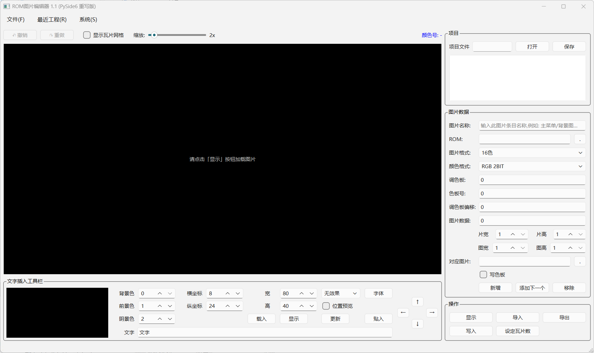

# ROM 图片编辑器 1.1 使用说明

> NDS/GBA ROM 瓦片图片编辑器 (PySide6 重写版)
> 兼容 Var1.0 / Var2.0 / Var3.0 .gpp 工程文件
> 原 VB6 版本作者: SHIKEYU ｜ 重写: Python 3.12 + PySide6

---

## 目录

1. [软件简介](#1-软件简介)
2. [安装与启动](#2-安装与启动)
3. [界面布局](#3-界面布局)
4. [基本操作流程](#4-基本操作流程)
5. [图片格式说明](#5-图片格式说明)
6. [地址与压缩格式](#6-地址与压缩格式)
7. [文字插入功能](#7-文字插入功能)
8. [瓦片翻转功能](#8-瓦片翻转功能)
9. [快捷键](#9-快捷键)
10. [常见问题](#10-常见问题)

---

## 1. 软件简介

本软件用于编辑 ROM 中的瓦片图形资源。支持从 ROM 中读取、显示、编辑瓦片图片，并将修改后的数据写回 ROM。主要面向 ROM 汉化、美术修改、资源提取等场景。

**核心功能：**
- 从 ROM 指定地址读取瓦片图片并显示
- 导入 / 导出 BMP、PNG、JPG 等格式的位图
- 将编辑后的瓦片数据写回 ROM（支持压缩格式写回）
- 在图片上插入文字（支持描边、阴影效果）
- MAP 图片瓦片去重 + 水平 / 垂直翻转匹配
- GPP 工程文件管理（多图片条目）

---

## 2. 安装与启动

### 2.1 环境要求

- Python 3.12+
- PySide6
- Pillow（可选，用于导入 PNG/JPG/TIFF 等格式）

### 2.2 安装依赖

```bash
pip install PySide6 Pillow
```

### 2.3 启动

在项目根目录执行：

```bash
python main.py
```

启动后看到主窗口：



---

## 3. 界面布局

主窗口分为三大区域：左侧画布区、底部文字工具栏、右侧配置面板。

### 3.1 菜单栏

| 菜单 | 快捷键 | 说明 |
|------|--------|------|
| 文件(F) | Alt+F | 新建 / 打开 / 保存 GPP 工程 |
| 最近工程(R) | Alt+R | 最近打开的工程（最多 10 个） |
| 系统(S) | Alt+S | 关于信息 |

**文件菜单项：**
- 新建(N) — Ctrl+N：清空所有数据，恢复初始状态
- 打开GPP项目(O) — Ctrl+O：打开已有 .gpp 工程文件
- 保存GPP项目(S) — Ctrl+S：保存当前工程
- 清空最近列表：清除最近打开记录

### 3.2 画布工具栏

位于菜单栏下方，包含：
- **撤销 / 重做** 按钮（支持 Ctrl+Z / Ctrl+Y）
- **显示瓦片网格** 复选框：叠加瓦片网格线（黄色 = 瓦片边界，红色 = 8 瓦片分隔）
- **缩放滑块**：1x ~ 16x 放大（也可用鼠标滚轮缩放）
- **颜色号标签**：显示右键取色或左键框选的信息（详见 [3.3 节](#33-画布区)）

### 3.3 画布区

中央黑色区域为图片显示画布。未加载时提示"请点击「显示」按钮加载图片"。

支持操作：

| 操作 | 功能 |
|------|------|
| 鼠标左键拖拽 | 框选矩形区域（按 8×8 瓦片对齐），用于「更新」功能的定向贴入 |
| 鼠标右键单击 | 拾取像素颜色号 + 显示坐标地址 |
| 鼠标滚轮 | 缩放画布（1x ~ 16x） |

**右键取色与取地址：**

右键点击画布任意像素后，工具栏右侧的「颜色号」标签会显示：
- 像素的调色板色号
- 像素的坐标位置 `(x, y)`

格式示例：`颜色号: 5 (位置 32,16)`

**左键框选与瓦片信息：**

左键拖拽框选完成后，「颜色号」标签会显示框选范围信息：
- 像素范围：起点和终点的像素坐标
- 瓦片范围：对应的瓦片索引（8 像素 = 1 瓦片）
- 选中的瓦片块数（列数 × 行数）

格式示例：`框选: 像素(0,0)-(31,31) 瓦片(0,0)-(3,3) 4×4块`

框选区域用于「框选更新」按钮的定向贴入（见 [第 7 节](#7-文字插入功能)）。

### 3.4 文字插入工具栏

位于画布下方，用于在图片上贴入文字。详见 [第 7 节](#7-文字插入功能)。

### 3.5 右侧配置面板

包含「项目」和「图片数据」两个分组。

**项目面板：**
- 项目文件路径输入框 + 打开 / 保存按钮
- 图片条目列表（可在列表中切换不同图片条目）

**图片数据面板** 的各字段：

| 字段 | 说明 |
|------|------|
| 图片名称 | 当前条目的标题（显示在列表中） |
| ROM | 目标 ROM 文件路径 |
| 图片格式 | 见 [第 5 节](#5-图片格式说明) |
| 颜色格式 | RGB 2BIT / RGB 3BIT / RGBA 4BIT |
| 调色板 | 调色板数据地址 |
| 色板号 | MAP 图片的调色板号 |
| 调色板偏移 | 调色板偏移值 |
| 图片数据 | 瓦片数据地址（支持压缩格式，见 [第 6 节](#6-地址与压缩格式)） |
| 片宽 / 片高 | 瓦片尺寸因子 |
| 图宽 / 图高 | 图片瓦片数 |
| 对应图片 | 导入 / 导出时使用的 BMP 文件路径 |
| 写色板 | 导入时是否同时写入调色板 |

**条目操作按钮：**
- **新增**：添加一个新的图片条目
- **添加下一个**：在当前条目后追加，标题自动加数字，地址自动计算
- **移除**：删除当前条目

**操作按钮：**
- **显示**：从 ROM 读取并在画布上显示图片
- **导入**：从 BMP/PNG 文件导入图片数据到画布
- **导出**：将画布图片导出为 BMP/PNG 文件
- **写入**：将画布数据写回 ROM
- **设定瓦片数**：重新统计 MAP 图片的瓦片数上限

---

## 4. 基本操作流程

### 4.1 典型工作流

```
打开GPP工程 → 选择条目 → 点击「显示」→ 编辑 → 「写入」ROM
```

或新建项目：

```
新建项目 → 填写ROM路径和地址 → 点击「显示」→ 编辑 → 「写入」
```

### 4.2 打开 GPP 工程

1. 菜单「文件」→「打开GPP项目」，或点击右侧「项目」面板的「打开」按钮
2. 选择 .gpp 文件
3. 左侧列表显示所有图片条目，点击条目可切换
4. 切换条目后会自动执行「显示」

### 4.3 显示图片

1. 在右侧面板填写 ROM 路径、图片数据地址、调色板地址等参数
2. 选择正确的图片格式和颜色格式
3. 设置图宽 / 图高（瓦片数）
4. 点击「显示」按钮
5. 图片显示在中央画布

### 4.4 导入 BMP

1. 先执行「显示」加载当前 ROM 图片
2. 在「对应图片」框填入 BMP 路径（或留空手动选择）
3. 勾选「写色板」可同时导入调色板
4. 点击「导入」按钮
5. 若「对应图片」路径有效且文件存在，直接导入；否则弹出文件选择对话框
6. 支持 BMP / PNG / JPG / TIFF 格式（需安装 Pillow）

### 4.5 导出 BMP

1. 先执行「显示」加载图片
2. 点击「导出」按钮
3. 选择保存格式（BMP 或 PNG，PNG 支持色号 0 透明）
4. 若文件已存在，会询问是否覆盖（默认选「否」防止误覆盖）
5. 导出后「对应图片」框自动更新为导出路径

### 4.6 写入 ROM

1. 先执行「显示」或「导入」加载图片数据
2. 点击「写入」按钮
3. 数据写回 ROM 指定地址
4. 压缩格式会自动重新压缩并写回（未修改的数据会跳过压缩以避免膨胀）
5. 写入成功后弹出提示

### 4.7 保存 GPP 工程

- 菜单「文件」→「保存GPP项目」，或点击「保存」按钮
- 保存所有图片条目的配置信息

---

## 5. 图片格式说明

| 格式 | 说明 | 瓦片大小 |
|------|------|----------|
| 16色 | 4bit/像素，每瓦片 32 字节 | 8×8 |
| 256色 | 8bit/像素，每瓦片 64 字节 | 8×8 |
| 超16色 | 16色瓦片 + 每瓦片 1 字节调色板基址 | 8×8 |
| PCE16色 | PCE 风格 4 位平面，16×16 | 16×16 |
| PCE16色8x8 | PCE 风格 4 位平面 | 8×8 |
| 16色BMP | 16色，直接 BMP 格式导入导出 | - |
| 256色BMP | 256色，直接 BMP 格式导入导出 | - |
| 16色MAP | 16色 MAP 格式（map 表 + 瓦片表） | 8×8 |
| 256色MAP | 256色 MAP 格式（map 表 + 瓦片表） | 8×8 |

**MAP 格式说明：**

MAP 图片由两部分组成：
- **map 表**：每个条目 2 字节，包含瓦片号(bits 0-9)、翻转标志(bits 10-11)、调色板号(bits 12-15)
- **瓦片表**：去重后的瓦片数据

写入时自动去重，并支持翻转匹配（详见 [第 8 节](#8-瓦片翻转功能)）。

---

## 6. 地址与压缩格式

### 6.1 地址输入格式

地址框支持多种格式：

| 格式 | 示例 | 说明 |
|------|------|------|
| 十进制 | 57344 | 直接十进制 |
| 0x 前缀 | 0xE000 | 十六进制 |
| &h 前缀 | &hE000 | VB6 风格十六进制 |

### 6.2 压缩格式

图片数据地址框支持以下压缩格式（通过分隔符区分）：

| 格式 | 地址写法 | 说明 |
|------|----------|------|
| RAW（无压缩） | `0x偏移` | 直接 ROM 内偏移 |
| LZ77 | `0x块地址;0x解压后偏移` | 分号分隔 |
| RLE | `0x块地址!0x解压后偏移` | 感叹号分隔 |
| Huffman | `0x块地址:0x解压后偏移` | 冒号分隔 |
| Huff+LZ77 | `0xHuff块地址:0xLZ77块地址;0x解压后偏移` | 两级压缩 |

**示例：**
- `0x800000` — 从 ROM 偏移 0x800000 直接读取
- `0x644D00;0x0` — LZ77 压缩，块在 0x644D00，解压后偏移 0
- `0x644D00:0x0` — Huffman 压缩，块在 0x644D00，解压后偏移 0
- `0x644D00:0x0;0x100` — Huff+LZ77，Huffman 块在 0x644D00，LZ77 块在 Huffman 流内偏移 0，解压后偏移 0x100

### 6.3 写入时的压缩

写入 ROM 时，会根据地址格式自动重新压缩数据：
- LZ77：使用 2 字节 hash + lazy matching + 重叠匹配
- Huffman：自动选择 4-bit 或 8-bit 模式中更小者
- Huff+LZ77：先 LZ77 压缩，再 Huffman 压缩
- 未修改的数据会跳过压缩写回，避免压缩器差异导致数据膨胀

---

## 7. 文字插入功能

文字插入工具栏位于画布下方，用于在图片上叠加文字。

### 7.1 控件逐项详解

工具栏按布局分为四行 + 方向键十字 + 文字输入框。下面按从上到下、从左到右的顺序逐一说明。

#### 第一行

| 控件 | 取值 / 操作 | 说明 |
|------|------------|------|
| **背景色** | 0–255，默认 0 | 文字底垫的调色板色号。不想要背景色时设为 0（前提是 0 号色为透明）。 |
| **横坐标** | 0–9999，默认 8 | 「坐标贴入」时文字左上角在主画布的像素 X 坐标。也会在主画布的绿色位置预览框中体现。 |
| **宽** | 0–9999，默认 80 | 「坐标贴入」时文字区域的裁剪宽度（像素）。贴入时只渲染这么宽，超出部分被裁掉。 |
| **效果** | 无效果 / 描边 / 阴影左上 / 阴影右上 / 阴影左下 / 阴影右下 | 6 种文字效果，见下方说明。 |
| **字体** | 弹出字体选择对话框 | 选择字体和字号。设置会保存到 QSettings，下次启动自动恢复。 |

#### 第二行

| 控件 | 取值 / 操作 | 说明 |
|------|------------|------|
| **前景色** | 0–255，默认 1 | 文字主体的调色板色号。 |
| **纵坐标** | 0–9999，默认 24 | 「坐标贴入」时文字左上角在主画布的像素 Y 坐标。 |
| **高** | 0–9999，默认 40 | 「坐标贴入」时文字区域的裁剪高度（像素）。 |
| **位置预览** | 勾选开关，默认关 | 勾选后，主画布会用**绿色虚线框**显示「坐标贴入」的位置和尺寸，便于定位。 |

#### 第三行

| 控件 | 取值 / 操作 | 说明 |
|------|------------|------|
| **阴景色** | 0–255，默认 2 | 描边/阴影效果使用的调色板色号。仅当效果为描边或阴影时生效。 |
| **载入** | 弹出文件选择框 | 从 BMP 文件加载参考图片到预览画布（切换到"图片模式"，覆盖文字渲染）。用于把已有 BMP 素材放到预览画布做框选源。 |
| **显示** | 点击按钮 | 在预览画布中渲染当前文字效果（**仅查看，不写入主画布**）。每次改变文字/颜色/效果后都要点一次刷新。 |
| **框选更新** | 点击按钮 | **定向替换**：把预览画布左键框选的区域贴到主画布左键框选的位置。两框尺寸必须完全一致。适合精确替换某个瓦片区域。 |
| **坐标贴入** | 点击按钮 | **按坐标全量贴入**：按 横坐标/纵坐标/宽/高 把文字渲染到主画布。像素做最近调色板色号匹配（RGB L2 距离）。适合固定坐标批量贴字。 |

#### 右侧：方向键十字

| 控件 | 说明 |
|------|------|
| **↑ ↓ ← →** | 像素级微调预览画布中文字的位置（不影响贴入坐标输入框）。用于精细对齐。 |

#### 底部：文字输入框

| 控件 | 说明 |
|------|------|
| **文字输入框** | 输入要贴入的文字。用 `\n` 表示换行（如 "第一行\n第二行"）。支持中英文混合。 |

#### 效果下拉框说明

| 效果 | 说明 |
|------|------|
| 无效果 | 只画前景色，不画边缘 |
| 描边 | 8 方向画边缘色（上下左右 + 4 个对角），再画前景色主体。适合在复杂背景上让文字突出。 |
| 阴影左上 | 边缘色偏移到 (-1,-1)，再画前景色主体。阴影落在文字左上方。 |
| 阴影右上 | 边缘色偏移到 (+1,-1)，阴影落在右上方。 |
| 阴影左下 | 边缘色偏移到 (-1,+1)，阴影落在左下方。 |
| 阴影右下 | 边缘色偏移到 (+1,+1)，阴影落在右下方。最常见的选择。 |

### 7.2 操作流程

1. 先「显示」加载目标图片到主画布
2. 在文字输入框输入文字（支持 `\n` 换行）
3. 设置前景色、背景色、阴景色
4. 选择效果（无效果 / 描边 / 阴影左上 / 阴影右上 / 阴影左下 / 阴影右下），阴影效果可选择阴影落在文字的左／右／上／下四个方向之一
5. 点击「字体」按钮选择字体和字号
6. 点击「显示」按钮在预览画布中渲染文字效果
7. 用方向键 ↑↓←→ 微调预览画布中的文字位置
8. 勾选「位置预览」可在主画布查看绿色虚线框（「坐标贴入」的目标位置和尺寸）
9. 点击「坐标贴入」或「框选更新」将文字写入主画布

### 7.3 预览画布

预览画布显示文字渲染效果。支持：
- 鼠标左键拖拽：框选区域（用于「框选更新」按钮的源区域）
- 方向键 ↑↓←→：像素级移动文字位置
- 「载入」按钮：从 BMP 加载参考图片到预览画布

### 7.4 「框选更新」与「坐标贴入」的区别

这两个按钮都把预览画布的文字内容写入主画布，但**定位方式和贴入范围不同**：

| 对比项 | 「框选更新」按钮 | 「坐标贴入」按钮 |
|--------|-------------|-------------|
| **定位方式** | 主画布左键框选的目标位置 | 横坐标 / 纵坐标输入框的值 |
| **贴入范围** | 预览画布左键框选的源区域 | 宽 / 高输入框的尺寸 |
| **前提条件** | 主画布和预览画布都需框选，且框选尺寸必须一致 | 只需设置横坐标/纵坐标/宽/高 |
| **适用场景** | 精确替换某个瓦片区域 | 按固定坐标批量贴入文字 |

**「框选更新」按钮详解（定向贴入）：**

1. 在主画布上**左键拖拽**框选目标区域（按 8×8 瓦片对齐）
2. 在预览画布上**左键拖拽**框选源区域
3. 两个框选区域的**像素尺寸必须完全一致**，否则提示错误
4. 点击「更新」后，预览框选区域的像素会贴到主画布框选位置
5. 适合**精确替换**主图某个区域的内容

**「坐标贴入」按钮详解（全量贴入）：**

1. 在「横坐标」「纵坐标」输入文字要贴入的左上角像素坐标
2. 在「宽」「高」输入文字区域的裁剪尺寸
3. 点击「贴入」后，按上述坐标和尺寸把文字渲染到主画布
4. 像素会做最近调色板色号匹配（RGB L2 距离）
5. 适合**按固定坐标**贴入整段文字

**使用建议：**
- 需要替换某个特定瓦片区域 → 用「框选更新」
- 需要在指定坐标贴入文字 → 用「坐标贴入」
- 两种操作都支持撤销（Ctrl+Z）

---

## 8. 瓦片翻转功能

### 8.1 功能说明

16色MAP 和 256色MAP 写入时，自动检查瓦片的四种变体进行去重：

| 变体 | 翻转标志位 | 说明 |
|------|-----------|------|
| 原始 | 0x00 | 无翻转 |
| 水平翻转 | 0x04 | bit 10 |
| 垂直翻转 | 0x08 | bit 11 |
| 水平+垂直 | 0x0C | bits 10+11 |

### 8.2 工作原理

写入 MAP 时，每个瓦片会依次检查原始、水平翻转、垂直翻转、水平+垂直翻转四种变体是否已在瓦片表中存在。若匹配则复用已有瓦片 ID 并设置对应的翻转标志，从而减少瓦片数量。

匹配时先做 CRC16 匹配，再做精确字节匹配，避免哈希碰撞误判。

### 8.3 设定瓦片数

「设定瓦片数」按钮用于重新统计当前 MAP 图片的瓦片数上限：
- 仅对 16色MAP / 256色MAP 有效
- 需先执行「显示」
- 统计后覆盖瓦片数缓存，后续「写入」时校验新瓦片数是否超限

---

## 9. 快捷键

| 快捷键 | 功能 |
|--------|------|
| Ctrl+N | 新建项目 |
| Ctrl+O | 打开 GPP 工程 |
| Ctrl+S | 保存 GPP 工程 |
| Ctrl+Z | 撤销 |
| Ctrl+Y | 重做 |
| 鼠标滚轮 | 画布缩放 |

---

## 10. 常见问题

### Q: 显示后图片是乱码 / 错位？

检查以下设置：
- 图片格式是否正确（16色 / 256色 / MAP 等）
- 调色板地址是否正确
- 图片数据地址是否正确
- 图宽 / 图高（瓦片数）是否匹配实际图片
- 颜色格式（RGB 2BIT / 3BIT / RGBA 4BIT）是否正确

### Q: 写入时报"瓦片数超出上限"？

MAP 图片写入时，去重后的瓦片数不能超过「显示」时统计的原始瓦片数。若导入了更多不同内容的瓦片，需要先「设定瓦片数」更新上限。

### Q: 压缩数据写回后变大了？

压缩器会尽力匹配原始压缩率。对于 Huff+LZ77 数据：
- LZ77 采用 2 字节 hash + lazy matching + 重叠匹配
- Huffman 自动选择 4-bit / 8-bit 中更小的模式
- 未修改的数据会跳过压缩直接写回，避免膨胀

### Q: 如何查看色板号对应的颜色？

在画布上鼠标右键点击像素，工具栏右侧「颜色号」会显示该像素的调色板索引。

### Q: 文字贴入后效果不对？

- 确保字体已正确选择（点击「字体」按钮）
- 描边/阴影效果需要设置正确的「阴景色」
- 文字位置由「横坐标 / 纵坐标」控制，宽/高用于裁剪
- 使用 `\n` 在文字输入框中表示换行

### Q: 支持哪些图片导入格式？

- BMP（原生支持）
- PNG / JPG / JPEG / TIFF（需安装 Pillow，自动量化为调色板色）

### Q: PNG 导出和 BMP 导出有什么区别？

- BMP：标准 BMP 格式
- PNG：色号 0 的像素设为透明，适合导出带透明通道的素材
